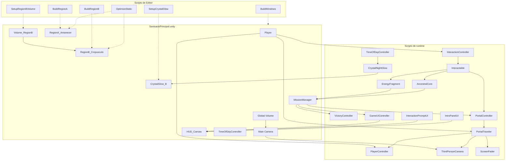
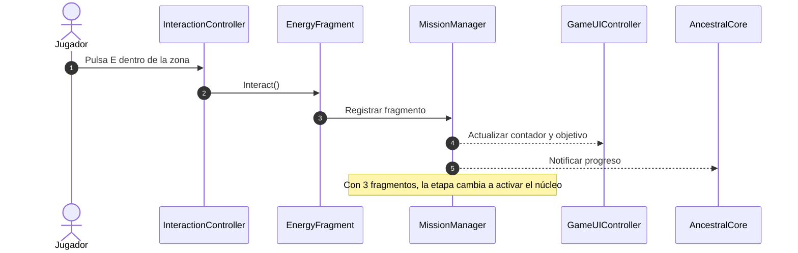

# ECHO: El Santuario del Tiempo

## Documentación académica del prototipo

**Proyecto:** ECHO: El Santuario del Tiempo<br>
**Tipo:** prototipo jugable 3D en tercera persona<br>
**Motor:** Unity 6000.6.2f1 con Universal Render Pipeline (URP) 17.6.0<br>
**Plataforma:** Windows x64<br>
**Escena:** `Assets/Scenes/SantuarioPrincipal.unity`<br>
**Estado del documento:** borrador técnico basado en el repositorio

> **Nota de veracidad:** este documento describe la implementación que consta en el repositorio. No afirma que las pruebas se hayan ejecutado, que el build se haya generado ni que se hayan obtenido métricas de rendimiento. Las cifras de FPS, batches y triángulos solo deben añadirse con evidencia de una ejecución real.

## 1. Resumen

ECHO: El Santuario del Tiempo es un prototipo de exploración y puzles en tercera persona. El jugador recorre dos regiones de un santuario, recoge tres fragmentos de energía, desbloquea un portal, cruza a una segunda región y activa un núcleo ancestral para completar la misión. El prototipo integra modelado de escenario con assets de Kenney, iluminación y cielo procedural, materiales con emisión, post-procesado, un ciclo día/noche, interfaces de usuario y una arquitectura de interacción basada en eventos.

El proyecto se desarrolla en una sola escena y con un único controlador de jugador, de acuerdo con las restricciones del curso. La documentación se apoya en los scripts, los assets y la escena existentes; cuando un dato no está confirmado, se indica expresamente.

## 2. Problema y contexto

El reto del proyecto es construir una experiencia 3D pequeña pero completa, que demuestre la aplicación de conceptos de computación gráfica y de diseño de interacción en un entorno controlado. El prototipo debe:

- Presentar un escenario 3D con identidad visual diferenciada en dos regiones.
- Permitir movimiento, cámara e interacción en tercera persona.
- Encadenar una misión con estados, requisitos y recompensa final.
- Aplicar iluminación, materiales, emisión y post-procesado propios de URP.
- Mantener una configuración razonable de rendimiento y una compilación reproducible para Windows.

El repositorio no incluye una copia del enunciado original. Por ello, los criterios académicos y de aceptación se derivan de `AGENTS.md`, de `docs/Fase7_Escenario.md`, de la escena y de los scripts. Deben cotejarse con el enunciado cuando esté disponible.

## 3. Objetivos

### 3.1 Objetivo general

Desarrollar un prototipo jugable en Unity que integre técnicas de renderizado, iluminación, composición de escena, interacción y optimización, con una misión completa y una build para Windows.

### 3.2 Objetivos específicos

1. Construir una escena principal con dos regiones conectadas por portales.
2. Implementar un controlador de jugador en tercera persona con cámara orbital y colisiones.
3. Diseñar un sistema de interacción reutilizable para fragmentos, portales y núcleo.
4. Gestionar el progreso de la misión mediante eventos y estados.
5. Aplicar URP con iluminación direccional, ambiente, cielo procedural, emisión y post-procesado.
6. Incorporar un ciclo día/noche con respuesta en luces y cristales.
7. Preparar herramientas de Editor idempotentes para construir y ajustar el escenario.
8. Generar una build Windows x64 mediante un script de Editor y un comando batch.

## 4. Justificación

La elección de URP responde a la necesidad de un pipeline moderno, configurable y adecuado para un prototipo académico en Windows. La separación entre scripts de runtime y herramientas de Editor permite reproducir ajustes de escenario sin editar YAML a mano. El uso de una sola escena reduce la complejidad de estado y facilita la prueba y la compilación.

La arquitectura prioriza la comunicación por eventos y referencias serializadas. Esto evita búsquedas costosas en cada frame y hace explícitas las dependencias entre misión, interfaz, portales y jugador. El resultado esperado es un prototipo comprensible, modificable y verificable.

## 5. Tecnologías utilizadas

| Tecnología | Versión / configuración | Uso en el proyecto |
|---|---|---|
| Unity | 6000.6.2f1 | Motor, Editor y compilación. |
| Universal Render Pipeline | 17.6.0 | Renderizado, iluminación, sombras y post-procesado. |
| Input System | 1.20.0 | Entrada de teclado y ratón. |
| uGUI | 2.6.0 | HUD, prompts, introducción y pantalla de victoria. |
| C# | Perfil de Unity 6 | Scripts de runtime y herramientas de Editor. |
| Kenney Nature Kit / Castle Kit | Assets del proyecto | Modelos del escenario. |
| Mermaid | Markdown | Diagramas de arquitectura y secuencia. |

## 6. Arquitectura del sistema

### 6.1 Composición de la escena

La escena `SantuarioPrincipal.unity` contiene, entre otros, los siguientes elementos:

| Elemento | Función |
|---|---|
| `Player` | Jugador con `PlayerController`, `CharacterController`, `PortalTraveler` y zona de interacción. |
| `Main Camera` | Cámara con `ThirdPersonCamera`, `UniversalAdditionalCameraData` y post-procesado. |
| `RegionA_Amanecer` | Región inicial: suelo, decoración, caminos, acantilados, portal A, fragmento 1 y núcleo. |
| `RegionB_Crepusculo` | Región secundaria: suelo, decoración, caminos, acantilados, escaleras, portal B y fragmentos 2 y 3. |
| `MissionManager` | Estado de la misión y eventos de progreso. |
| `HUD_Canvas` | Interfaz de juego: contador, objetivo, prompt, avisos, introducción y victoria. |
| `TimeOfDayController` | Sol, cielo, ambiente y reloj del ciclo día/noche. |
| `Global Volume` | Perfil global de post-procesado de la escena. |
| `Volume_RegionB` | Volumen local de post-procesado para la región B. |
| `CrystalGlow_B` | Control de emisión nocturna de los cristales de la región B. |

La escena real se encuentra en `Assets/Scenes/SantuarioPrincipal.unity`. `AGENTS.md` menciona una ruta `Assets/_Project/Scenes/...` que no coincide con la ubicación actual; para cualquier automatización debe usarse la ruta real.

### 6.2 Módulos de runtime

| Módulo | Responsabilidad | API o punto de entrada |
|---|---|---|
| `Echo.Player.PlayerController` | Movimiento, gravedad, salto, rotación y control. | `SetControlEnabled(bool)`, `Teleport(Vector3, Quaternion)` |
| `Echo.CameraSystem.ThirdPersonCamera` | Órbita, zoom, colisión de cámara y reorientación. | `SnapTo(float yaw)`, `SetInputEnabled(bool)` |
| `Echo.Interactions.Interactable` | Contrato abstracto de interacción. | `Interact()` y propiedades de prompt. |
| `Echo.Interactions.InteractionController` | Detección por capa `Interactable` y prompt. | Componente del jugador. |
| `Echo.Mission.MissionManager` | Fragmentos, etapas, requisitos y eventos. | Eventos de progreso y victoria. |
| `Echo.Mission.EnergyFragment` | Recogida de un fragmento. | `Interactable`. |
| `Echo.Mission.AncestralCore` | Activación final del núcleo. | `Interactable`. |
| `Echo.Mission.VictoryController` | Panel de victoria y reinicio. | Botón de reinicio. |
| `Echo.Portals.PortalController` | Requisito y destino del portal. | `Interactable`. |
| `Echo.Portals.PortalTraveler` | Fundido, teletransporte y enfriamiento. | Componente del jugador. |
| `Echo.UI.GameUIController` | Contador, objetivo y avisos. | Eventos de misión. |
| `Echo.UI.InteractionPromptUI` | Prompt contextual. | Eventos de interacción. |
| `Echo.UI.IntroPanelUI` | Introducción y tecla `H`. | Canvas. |
| `Echo.UI.ScreenFader` | Fundidos de pantalla. | Viajes y transiciones. |
| `Echo.World.TimeOfDayController` | Ciclo día/noche y luces. | `NightFactor`, `SetTimeOfDay(float)` |
| `Echo.World.CrystalNightGlow` | Emisión nocturna de cristales. | `MaterialPropertyBlock`. |

### 6.3 Herramientas de Editor

Las herramientas de Editor viven en `Assets/Scripts/Editor` y usan el namespace `Echo.EditorTools`. Su objetivo es recrear o ajustar partes del escenario de forma idempotente, sin duplicar objetos y sin editar archivos YAML manualmente.

| Herramienta | Menú | Función |
|---|---|---|
| `BuildRegionA` / `BuildRegionB` | `Tools/ECHO/...` | Construcción del escenario de cada región. |
| `SetupCrystalGlow` | `Tools/ECHO/Setup Crystal Glow` | Añade y enlaza `CrystalNightGlow` a los cristales. |
| `SetupRegionBVolume` | `Tools/ECHO/Setup Region B Volume` | Crea el perfil y el volumen local de la región B. |
| `OptimizeStatic` | `Tools/ECHO/Optimize Static` | Marca contenedores con `Batching Static` y omite luces. |
| `BuildWindows` | `Tools/ECHO/Build Windows` | Genera la build Windows x64 en `Builds/`. |

`BuildWindows` se añadió como parte de esta documentación. Su ejecución y la de los demás menús debe verificarse en Unity; no consta en el repositorio que se hayan ejecutado ni que hayan producido los artefactos esperados.

### 6.4 Comunicación entre sistemas

La misión actúa como eje de estado. Los fragmentos notifican su recogida, `MissionManager` actualiza contadores y etapas, y emite eventos que consumen la interfaz, el núcleo, los portales y la pantalla de victoria. Los portales consultan el estado de la misión antes de permitir el viaje. El jugador y la cámara se deshabilitan durante transiciones y victoria, y se rehabilitan al terminar.

Este diseño busca:

- Evitar `FindObjectOfType` en `Update`.
- Mantener referencias explícitas mediante `[SerializeField]`.
- Separar lógica de misión, presentación y navegación.
- Permitir que las herramientas de Editor validen referencias y muestren errores claros.

### 6.5 Diagrama de módulos



### 6.6 Secuencia de recogida de un fragmento



## 7. Conceptos de computación gráfica aplicados

### 7.1 Pipeline de renderizado

El proyecto usa URP con las siguientes características observadas en los assets de configuración:

| Aspecto | Valor en el repositorio | Efecto |
|---|---|---|
| Renderer | `PC_Renderer.asset`, `m_RenderingMode: 2` | Forward+ (el valor 2 corresponde a Forward+ en el enum de URP). |
| Espacio de color | Lineal (`m_ActiveColorSpace: 1`) | Iluminación y mezcla en espacio lineal. |
| HDR | Activo en `PC_RPAsset` y en la cámara | Mayor rango para emisión y bloom. |
| MSAA | 1x | Sin antialiasing por MSAA en el asset. |
| Render scale | 1 | Resolución interna completa. |
| Sombras principales | 2048, distancia 60 | Sombras direccionales con alcance limitado. |
| Luces adicionales por objeto | 4 | Límite real de `PC_RPAsset`. |

La configuración de Forward+ permite evaluar luces adicionales en tile/cluster, lo que resulta coherente con un escenario con faroles y cristales. La lectura de estos valores debe hacerse en los assets, no solo en la documentación, porque `AGENTS.md` menciona un límite de 8 luces que no coincide con el valor actual del asset.

### 7.2 Iluminación y cielo

La escena combina:

- Una luz direccional que representa el sol, controlada por `TimeOfDayController`.
- Ambiente Trilight, con colores de cielo, ecuador y suelo.
- Un skybox procedural con tinte, exposición y grosor de atmósfera ajustables.
- Luces puntuales en faroles y cristales.
- Emisión en materiales de cristales, portales y núcleo.

`TimeOfDayController` actualiza la rotación solar, el tinte del cielo, la exposición, la atmósfera, el ambiente y las luces nocturnas. La tecla `1` fija amanecer, `2` mediodía, `3` atardecer y `4` medianoche; `P` pausa y `F` acelera el ciclo. Estos controles son de prueba y deben verificarse en ejecución.

### 7.3 Materiales y emisión

Los materiales principales usan el shader `Universal Render Pipeline/Lit`, de acuerdo con la restricción del proyecto. La emisión se emplea para dar identidad a objetos mágicos:

| Material | Emisión observada | Uso |
|---|---|---|
| `M_Crystal_Violet` | `(1.6, 0.2, 2.2)` | Cristales violetas. |
| `M_Portal` | `(0, 5.656854, 5.656854)` | Superficie del portal. |
| `M_Core` | Emisión inicial negra; el núcleo la modifica en runtime | Núcleo ancestral. |

`CrystalNightGlow` recorre los cristales y modifica su emisión mediante `MaterialPropertyBlock`, lo que evita duplicar materiales y conserva el batching. Si el material no expone `_EmissionColor`, el script usa el color base como respaldo.

### 7.4 Post-procesado

El proyecto usa un volumen global con el perfil `SampleSceneProfile` y un volumen local en la región B con el perfil `VP_RegionB`.

`VP_RegionB` contiene:

| Efecto | Valores observados | Intención |
|---|---|---|
| Color Adjustments | Post exposure −0.3, filtro `(0.784, 0.667, 1)`, saturación +15 | Tinte violeta y ambiente crepuscular. |
| Vignette | Intensidad 0.3 | Oscurecimiento de bordes. |
| Bloom | Umbral 0.9, intensidad 1.2 | Resplandor de cristales y luces. |

El volumen local no es global, tiene peso 1, prioridad 1 y una distancia de mezcla de 8. Su caja de activación mide 84 × 30 × 84 y está centrada en la región B. La cámara principal tiene `m_RenderPostProcessing: 1`, condición necesaria para que estos efectos se apliquen.

### 7.5 Optimización

Las estrategias documentadas en el repositorio son:

- **Static batching:** `OptimizeStatic` marca `Batching Static` en contenedores de decoración, caminos, acantilados y escaleras. No marca portales, fragmentos, núcleo, cristales ni luces.
- **Materiales compartidos:** el uso de `MaterialPropertyBlock` en cristales evita instancias de material por objeto.
- **Límite de luces:** `PC_RPAsset` limita las luces adicionales por objeto a 4. `OptimizeStatic` advierte si una región supera 8 luces en total, pero ese umbral es una recomendación del script y no el límite del pipeline.
- **Escena única:** reduce el coste de carga y la complejidad de estado.
- **Medición pendiente:** no hay cifras de FPS, batches o triángulos en el repositorio. Deben obtenerse con Stats y registrarse en el plan de pruebas.

### 7.6 Cámara y física

`ThirdPersonCamera` implementa una cámara orbital con:

- Distancia objetivo de 5 m, mínima de 1 m.
- Sensibilidad de 0.12.
- Pitch limitado entre −25° y 60°.
- `SphereCast` de radio 0.25 para evitar atravesar geometría.
- Suavizado de seguimiento y bloqueo de cursor.

`PlayerController` usa `CharacterController` con altura 1.8 m, radio 0.3 m, `stepOffset` 0.3 m y límite de pendiente de 45°. El movimiento es relativo a la cámara y la gravedad se aplica manualmente. El jugador se teleporta con `Teleport(Vector3, Quaternion)` y la cámara se reorienta con `SnapTo(float yaw)`.

### 7.7 Entrada

El proyecto usa el Input System nuevo (`UnityEngine.InputSystem`). Los scripts consultan `Keyboard.current` y `Mouse.current`; no se usa `UnityEngine.Input` clásico. Las teclas de prueba del ciclo día/noche son `1`–`4`, `P` y `F`. La interacción usa `E`; la introducción se alterna con `H`.

## 8. Flujo de juego

| Etapa | Condición | Resultado |
|---|---|---|
| Inicio | Carga de la escena | Introducción, HUD en 0/3 y objetivo de explorar. |
| Exploración A | Movimiento libre | El jugador puede recoger el fragmento 1. |
| Portal A | 1 fragmento recogido | El portal permite viajar a la región B. |
| Región B | Llegada al marcador | El jugador explora y recoge los fragmentos 2 y 3. |
| Regreso | Interacción con el portal B | El jugador vuelve a la región A. |
| Núcleo | 3 fragmentos | El núcleo se activa y completa la misión. |
| Victoria | Núcleo activado | Panel de victoria, control bloqueado y opción de reinicio. |
| Reinicio | Botón de victoria | La escena se recarga y vuelve al estado inicial. |

## 9. Guion de demostración

El siguiente guion sirve para una demostración breve. No sustituye la ejecución de pruebas ni permite afirmar que el prototipo funciona sin haberlo probado.

1. **Apertura (30 s).** Abrir `Assets/Scenes/SantuarioPrincipal.unity`, pulsar Play y mostrar la introducción, el HUD y el objetivo inicial.
2. **Movimiento y cámara (60 s).** Caminar con `WASD`, correr con `Shift`, orbitar con el ratón y mostrar que la cámara evita paredes. Pulsar `Esc` para liberar el cursor.
3. **Interacción y fragmento 1 (60 s).** Ir a `Fragment_1` en `(-25, 1, 20)`, mostrar el prompt y recogerlo con `E`. Señalar el cambio a 1/3.
4. **Portal bloqueado y desbloqueado (60 s).** Mostrar primero el portal con 0 fragmentos en una partida nueva si el tiempo lo permite; después, con 1 fragmento, cruzar a la región B y comentar el fundido y la reorientación de cámara.
5. **Región B y fragmentos (90 s).** Recoger `Fragment_2` en `(225, 1, 20)` y subir a por `Fragment_3` en la instancia `(190, 2.5, 32)`. Mostrar el HUD en 3/3.
6. **Ambiente (60 s).** Mostrar el tinte, la viñeta, el bloom y los cristales de B. Pulsar `4` para medianoche y observar faroles y emisión; volver a `1` para amanecer.
7. **Núcleo y victoria (60 s).** Regresar por el portal B, ir al núcleo en `(0, 0, 30)`, activarlo y mostrar el panel de victoria.
8. **Cierre (30 s).** Pulsar reinicio, comprobar que vuelve el estado inicial y mencionar las limitaciones y pendientes documentados.

Durante la demostración conviene tener abierta la consola de Unity para detectar errores rojos o referencias faltantes. Si algún paso falla, debe registrarse como incidencia; no debe presentarse como correcto.

## 10. Compilación y ejecución

### 10.1 Build desde el menú

1. Abrir la escena `Assets/Scenes/SantuarioPrincipal.unity`.
2. Guardar la escena si hay cambios.
3. Ejecutar `Tools/ECHO/Build Windows`.
4. Revisar la consola y el reporte del build.
5. Comprobar la salida en `Builds/ECHO_SantuarioDelTiempo.exe` y `Builds/ECHO_SantuarioDelTiempo_Data/`.

El script valida que la escena exista, que el Editor no esté en Play Mode ni compilando, y que el módulo Windows x64 esté instalado. Si la escena activa tiene cambios sin guardar, muestra una advertencia y compila la última versión guardada. No modifica `EditorBuildSettings` ni `ProjectSettings`.

### 10.2 Build por línea de comandos

El mismo método puede invocarse en batch:

```powershell
& "C:\Program Files\Unity\Hub\Editor\6000.6.2f1\Editor\Unity.exe" `
  -batchmode -quit `
  -projectPath "C:\Proyectos\ECHO_SantuarioDelTiempo" `
  -executeMethod Echo.EditorTools.BuildWindows.Build `
  -logFile "C:\Proyectos\ECHO_SantuarioDelTiempo\Logs\build-windows.log"
```

El script llama a `EditorApplication.Exit(0)` si el build termina correctamente y a `EditorApplication.Exit(1)` si falla. El proceso debe revisarse por código de salida y por el log. La ruta de Unity debe ajustarse a la instalación real de la máquina.

### 10.3 Ejecución

El ejecutable se lanza desde `Builds/ECHO_SantuarioDelTiempo.exe`. La carpeta `_Data` debe permanecer junto al ejecutable. `Builds/` está excluida del control de versiones.

## 11. Estado de verificación y limitaciones

### 11.1 Estado

- Los scripts de runtime y las herramientas de Editor de las fases anteriores constan en el repositorio.
- El plan de pruebas está en `docs/PlanDePruebas.md`, con la columna de resultados vacía.
- El script `BuildWindows.cs` se añadió, pero no se ha compilado ni ejecutado desde este entorno.
- No consta que se hayan ejecutado los menús `Setup Crystal Glow`, `Setup Region B Volume` ni `Optimize Static`.
- No hay mediciones de rendimiento en el repositorio.

### 11.2 Limitaciones y discrepancias observadas

- La escena contiene `Test_Wall`, `Test_Step` y `Test_Tall`, que la Fase 7 pedía eliminar. No se modifican en esta tarea.
- Solo existe `CrystalGlow_B`; no hay `CrystalGlow_A`. Si el brillo nocturno debe aplicarse a ambas regiones, queda pendiente.
- El archivo `Assets/Scripts/Mission/EnergyFragment..cs` no cumple la convención de nombre de archivo. No se renombra para no alterar el asset ni su `.meta`.
- La instancia real de `Fragment_3` está en `(190, 2.5, 32)`. `AGENTS.md` indica `(190, 1, 35)` y el marcador antiguo está en `(190, 3, 35)`; debe usarse la instancia real al probar.
- `AGENTS.md` menciona un límite de 8 luces cerca del jugador, pero `PC_RPAsset` limita las luces adicionales por objeto a 4. La documentación usa el valor del asset.
- La ruta de escena de `AGENTS.md` (`Assets/_Project/Scenes/...`) no coincide con la ruta real (`Assets/Scenes/...`).
- No se incluyen cinemática, animaciones, audio, IA, inventario, guardado ni multijugador, de acuerdo con las restricciones del proyecto.

## 12. Referencias internas

- `AGENTS.md`: reglas, estructura, estado y convenciones.
- `docs/Fase7_Escenario.md`: criterios de escenario y optimización.
- `docs/PlanDePruebas.md`: casos de prueba y registro de resultados.
- `Assets/Scenes/SantuarioPrincipal.unity`: escena principal.
- `Assets/Settings/PC_RPAsset.asset` y `Assets/Settings/PC_Renderer.asset`: configuración URP.
- `Assets/VFX/VP_RegionB.asset`: perfil de post-procesado de la región B.
- `Assets/Materials/M_Crystal_Violet.mat`, `M_Portal.mat`, `M_Core.mat` y `M_Skybox_Procedural.mat`: materiales principales.
- `Assets/Scripts/Editor/BuildWindows.cs`: build Windows x64.
- `Assets/Scripts/Editor/SetupCrystalGlow.cs`, `SetupRegionBVolume.cs` y `OptimizeStatic.cs`: herramientas de escenario.

## 13. Referencias de apoyo

- Marschner, S. y Shirley, P. (2015). *Fundamentals of Computer Graphics* (4.ª ed.). CRC Press.
- Akenine-Möller, T., Haines, E., Hoffman, N., Pesce, A., Iwanicki, M. y Hillaire, S. (2018). *Real-Time Rendering* (4.ª ed.). CRC Press.
- Unity Technologies. *Universal Render Pipeline documentation*. Documentación oficial del paquete URP.
